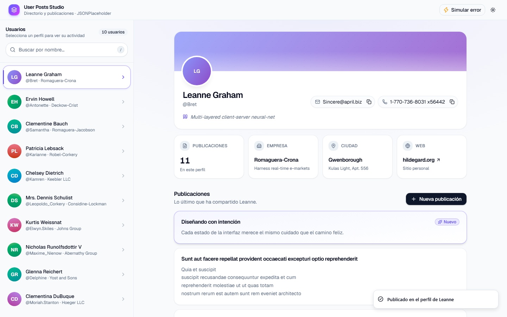
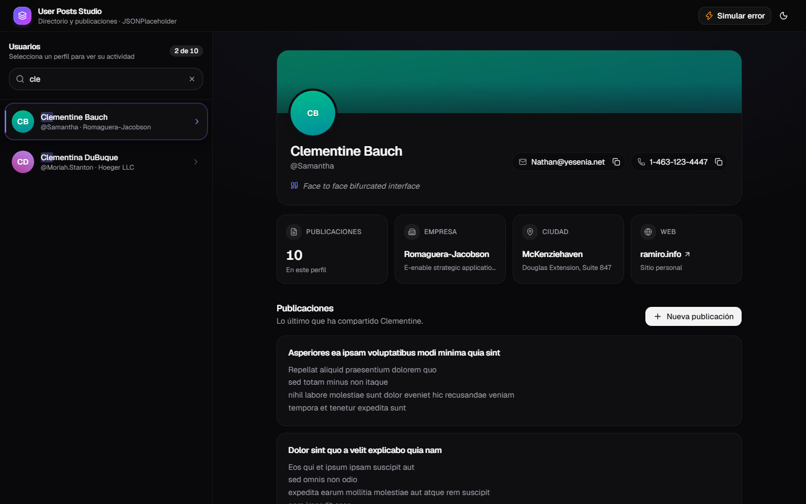
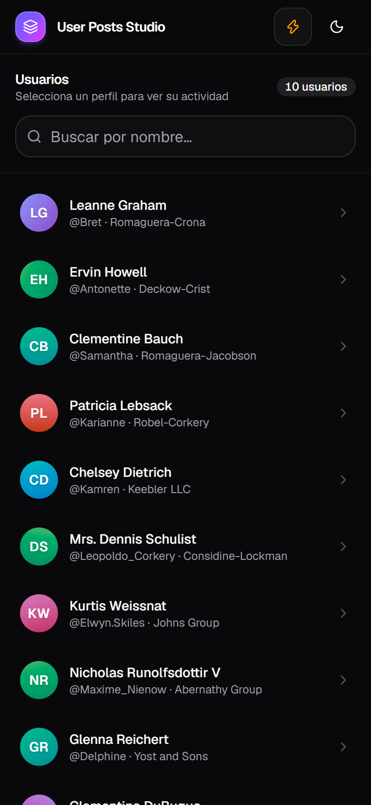
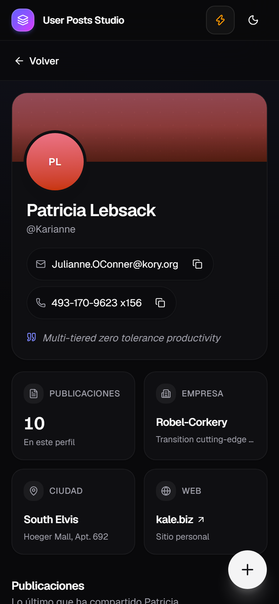
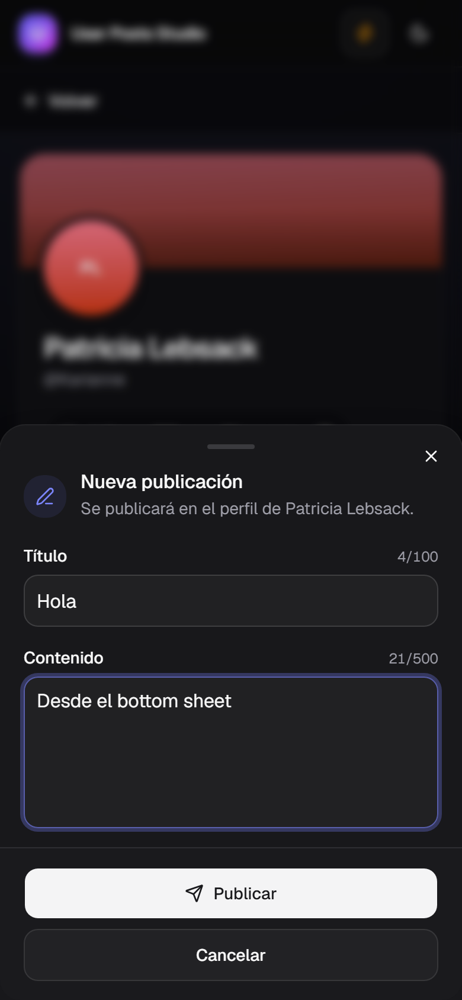
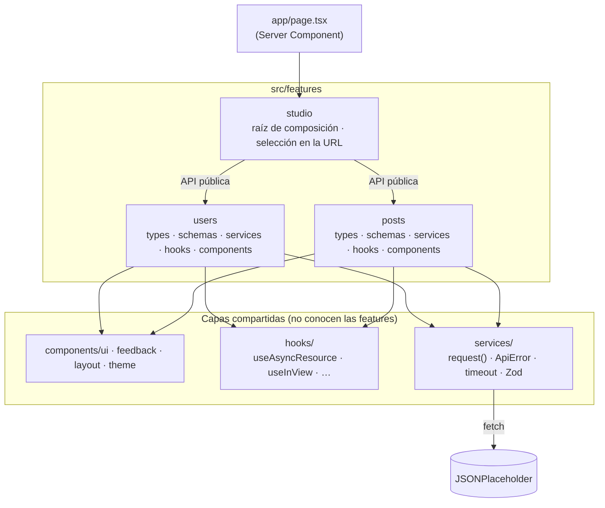

# User Posts Studio

Explorador de usuarios y publicaciones con experiencia **master-detail** de nivel SaaS, construido sobre
la API pública de [JSONPlaceholder](https://jsonplaceholder.typicode.com). Prueba técnica frontend con
**Next.js 16 (App Router)**, **TypeScript estricto**, **Tailwind CSS 4**, **shadcn/ui** y una suite de
tests por capas que va de la unidad al navegador real.



<table>
  <tr>
    <td></td>
  </tr>
</table>

<p align="center">
  
  
  
</p>

---

## Índice

- [Funcionalidades](#funcionalidades)
- [Puesta en marcha](#puesta-en-marcha)
- [Arquitectura](#arquitectura)
- [Decisiones técnicas y de UX](#decisiones-técnicas-y-de-ux)
- [Testing](#testing)
- [Qué haría con más tiempo](#qué-haría-con-más-tiempo)
- [Uso de IA](#uso-de-ia)

## Funcionalidades

**Directorio (panel maestro)**

- Búsqueda instantánea por nombre, sin distinguir mayúsculas **ni acentos** ("jose" encuentra "José"),
  con resaltado de coincidencias, contador `3 de 10`, limpieza con `X` o `Esc` y atajo global `/`.
- Skeletons con la geometría exacta de las tarjetas (sin saltos de layout) y estado vacío ilustrado.
- Errores con icono según su causa (red, timeout, HTTP, contrato roto) y **Reintentar** funcional.
  El botón **Simular error** fuerza un fallo de red para ver el flujo completo.

**Perfil (panel de detalle)**

- Cabecera con avatar y banner de **gradiente determinista** (misma persona, mismos colores en
  cualquier dispositivo; paleta OKLCH curada).
- Email y teléfono con **copiar al portapapeles** (icono animado, tooltip y toast).
- Métricas rápidas: publicaciones, empresa, ciudad y web.
- Feed de publicaciones con entrada escalonada y skeletons propios.

**Creación de publicaciones**

- Diálogo validado con **Zod + React Hook Form**: título (3–100) y contenido (10–500), medidos
  **tras recortar espacios**, con contador en vivo que avisa al acercarse al límite.
- `Enter` en el título salta al contenido; `Ctrl + Enter` publica.
- **UI optimista:** la publicación aparece al instante con el badge **Nuevo**, se confirma con la
  respuesta del servidor y **se revierte** con un toast si la API la rechaza. Las publicaciones creadas
  sobreviven al cambio de perfil.

**Experiencia**

- **Tema claro/oscuro** (sistema por defecto) con transición de **revelado circular** (View
  Transitions API) que respeta `prefers-reduced-motion`.
- La **URL es la fuente de verdad** (`/?user=3`): enlaces directos, recarga sin perder contexto y
  botón/gesto **atrás** que recorre las selecciones.
- **Móvil nativo:** navegación tipo push (lista ↔ detalle), barra superior fija que muestra la
  identidad compacta al hacer scroll, **botón flotante** para publicar, el diálogo se convierte en
  **bottom sheet**, objetivos táctiles ≥ 36 px (`pointer: coarse`) y teclado virtual que no tapa el
  formulario (`interactive-widget=resizes-content`).

## Puesta en marcha

Requisitos: **Node.js ≥ 22** (ver `.nvmrc`) y npm.

```bash
npm ci
npm run dev          # http://localhost:3000
```

| Script                                                        | Qué hace                                                                                    |
| ------------------------------------------------------------- | ------------------------------------------------------------------------------------------- |
| `npm run dev`                                                 | Servidor de desarrollo (Turbopack)                                                          |
| `npm run build` / `npm start`                                 | Build de producción y servidor                                                              |
| `npm test`                                                    | Vitest en modo watch (`npm test -- --run` para una sola pasada)                             |
| `npm run e2e`                                                 | Playwright: E2E funcional + accesibilidad, escritorio y móvil, sobre el build de producción |
| `npm run e2e:headed`                                          | Lo mismo con el navegador visible (`SLOWMO=300` para seguirlo a ojo)                        |
| `npm run e2e:visual:update` / `npm run e2e:visual`            | Genera y compara las líneas base de regresión visual                                        |
| `npm run lint` / `npm run typecheck` / `npm run format:check` | Calidad estática                                                                            |
| `npm run check`                                               | Formato + lint + tipos + tests en un solo comando                                           |

> La primera ejecución de Playwright necesita el navegador: `npx playwright install --no-shell chromium`.

## Arquitectura

Arquitectura **por features** con fronteras **verificadas por ESLint**
([ADR 0001](docs/adr/0001-arquitectura-por-features.md)).



```text
src/
├── app/                      # Solo routing: layout, page, error boundary, estilos globales
├── features/
│   ├── users/                # Directorio y perfil
│   │   ├── components/       # UsersPanel, UserCard, UserProfile, UserStats, skeletons…
│   │   ├── hooks/            # useUsers (incluye el modo "fallo simulado")
│   │   ├── services/         # getUsers()
│   │   ├── schemas.ts        # Contrato Zod de /users
│   │   ├── types.ts          # User, Address, Company
│   │   └── index.ts          # ← API pública
│   ├── posts/                # Feed y creación
│   │   ├── components/       # PostFeed, PostCard, CreatePostDialog…
│   │   ├── hooks/            # useUserPosts, useCreatedPosts (optimista + rollback)
│   │   ├── services/         # getUserPosts(), createPost()
│   │   ├── schemas.ts        # Formulario + contrato de /posts
│   │   └── types.ts / index.ts
│   └── studio/               # Compone users + posts; la selección vive en la URL
├── components/               # ui (shadcn), feedback (error/empty), layout, theme, copy-button
├── hooks/                    # Hooks transversales
├── lib/                      # avatar, search, utils
├── services/                 # Cliente HTTP, ApiError, inyección de fallos
└── test/                     # Setup de Vitest, servidor MSW, fixtures
e2e/                          # Playwright: journeys, móvil, accesibilidad, visual, contrato
docs/adr/                     # Architecture Decision Records
```

**Reglas que hace cumplir el lint:**

1. Fuera de una feature solo se importa su API pública (`@/features/posts`), nunca sus internos.
2. Las capas compartidas (`components`, `hooks`, `lib`, `services`) no pueden importar features.

## Decisiones técnicas y de UX

**Por qué master-detail.** Es el patrón natural para "explorar una colección y ver el detalle de un
elemento": en escritorio permite comparar perfiles sin perder la lista (panel de 360–380 px con
scroll independiente) y en móvil se degrada a dos pantallas con navegación tipo push. Ambos paneles
tienen scroll propio, de modo que la búsqueda y la posición de la lista se conservan.

**Selección en la URL** ([ADR 0002](docs/adr/0002-seleccion-en-la-url.md)). `useSyncExternalStore`
sobre la History API nativa: enlaces compartibles, recarga sin pérdida y el gesto atrás del móvil
vuelve a la lista en lugar de salir de la app.

**Data fetching sin condiciones de carrera** ([ADR 0003](docs/adr/0003-fetching-sin-libreria-de-cache.md)).
`useAsyncResource` deriva el estado de carga del `requestId` en lugar de asignarlo en el efecto. Una
respuesta tardía del usuario anterior no puede pintarse nunca, y las peticiones obsoletas se abortan.

**Defensa en la frontera.** `request()` aplica timeout (10 s), distingue cancelación de fallo,
normaliza todo error a un `ApiError` tipado y **valida cada respuesta con Zod**. Si la API cambia su
contrato, falla con un mensaje claro en lugar de romper un componente. Los schemas están anotados con
las interfaces de dominio (`z.ZodType<User>`), así que tipos y validación no pueden divergir.

**UI optimista.** Insertar → confirmar → revertir. Como JSONPlaceholder responde `id: 101` a todos
los `POST`, cada publicación local usa una **clave de cliente** estable para React. El store de
publicaciones creadas vive en la raíz de composición, por encima de la vista de detalle (que se
remonta por usuario), y por eso sobreviven al cambio de perfil.

**TypeScript más estricto que `strict`.** `noUncheckedIndexedAccess`, `noImplicitOverride` y
`noFallthroughCasesInSwitch`. Sin `any`.

**Accesibilidad.** Landmarks y jerarquía de encabezados, `aria-current` en la selección, `role="status"`
en las cargas, `role="alert"` en los errores, contador con `aria-live`, foco gestionado por el
diálogo y el resaltado de búsqueda oculto a lectores de pantalla (leen el nombre limpio, sin
fragmentar ni anunciar "resaltado"). Se verifica con axe en cada estado clave.

**Diseño.** Tokens OKLCH (fondos `slate-50` / `zinc-950`, bordes sutiles y un único acento índigo
usado con mesura), tipografía Geist, micro-interacciones con `transform`/`opacity` y todo el
movimiento condicionado a `motion-safe`.

**Desviaciones conscientes del enunciado**

- **Estructura:** las capas `types`, `services`, `hooks` y `schemas` existen, pero **dentro de cada
  feature**; la infraestructura compartida sigue en `src/services` y `src/hooks`.
- **`@vitejs/plugin-react` no se usa.** Vitest 5 corre sobre Vite 8, cuyo transformador nativo (Oxc)
  ya compila TSX con el runtime automático. El plugin solo aportaría Fast Refresh (irrelevante en
  tests) y su versión 6 arrastra un peer opcional de Babel 8 RC que entra en conflicto con el Babel 7
  de shadcn. Antes que forzar `--legacy-peer-deps`, se prescinde de él.
- **shadcn/ui 4** genera por defecto el estilo `base-nova` sobre **Base UI** (no Radix). Se adoptó
  tal cual; los componentes se adaptaron donde aportaba valor (el diálogo es un bottom sheet en
  móvil).

## Testing

Estrategia por capas ([ADR 0004](docs/adr/0004-estrategia-de-testing.md)):

| Capa          | Herramientas                                | Cobertura                                                                                                                                  |
| ------------- | ------------------------------------------- | ------------------------------------------------------------------------------------------------------------------------------------------ |
| Unitaria      | Vitest                                      | Schemas en sus límites exactos, avatar, búsqueda, cliente HTTP (timeout, cancelación, contrato roto), condición de carrera                 |
| Integración   | Vitest + Testing Library + **MSW**          | Búsqueda y filtrado, skeleton → error → reintento, fallo simulado, selección + URL, deep link, validación, publicación optimista, rollback |
| E2E           | **Playwright** sobre el build de producción | Recorridos críticos en escritorio y en Pixel 7 (táctil): historial, bottom sheet, barra fija, overflow y objetivos táctiles                |
| Accesibilidad | Playwright + **axe-core**                   | WCAG 2.2 AA en directorio, perfil, diálogo con errores y estado de error, en claro y oscuro                                                |
| Visual        | Playwright `toHaveScreenshot`               | Pantallas clave en ambos temas y layouts (líneas base locales)                                                                             |
| Contrato      | Playwright `@live`                          | Smoke contra la API real                                                                                                                   |

Los tests consultan por **roles y nombres accesibles** (lo que percibe el usuario) y la red se
intercepta en su capa real (MSW en Node, `page.route` en el navegador): se prueba el código de
producción de punta a punta.

**CI (GitHub Actions):** formato → lint → tipos → unit/integración → build, y después E2E +
accesibilidad en escritorio y móvil, con el reporte HTML como artefacto.

## Qué haría con más tiempo

- **TanStack Query:** caché persistente entre navegaciones, deduplicación, revalidación en segundo
  plano y mutaciones optimistas declarativas (`onMutate`/`onError`). La migración es casi uno a uno.
- **Escala:** paginación o scroll infinito y **virtualización** (TanStack Virtual) para miles de
  usuarios o publicaciones.
- **Regresión visual en CI** con líneas base generadas en la imagen Docker de Playwright, y cobertura
  de **Firefox y WebKit**.
- **Accesibilidad WCAG AAA:** auditoría de contraste 7:1, pruebas manuales con NVDA/VoiceOver y
  navegación completa por teclado del listado con flechas (roving tabindex).
- **Calidad continua:** Storybook para el sistema de diseño, Lighthouse CI con presupuestos de
  rendimiento, observabilidad (Sentry + Web Vitals) y **React Compiler**.
- **Producto:** edición y borrado de publicaciones, i18n (`next-intl`), CSP con nonces y
  modo offline (PWA).

## Uso de IA

Este proyecto se construyó con un asistente de IA (Claude Code) trabajando en el repositorio bajo la
dirección del autor, que fijó los requisitos, revisó cada iteración y tomó las decisiones de
producto y arquitectura.

**Qué se le pidió a la IA**

- Scaffolding no interactivo (Next.js, shadcn/ui, Vitest, Playwright) y configuración de la calidad
  (ESLint, Prettier, TypeScript estricto, CI).
- Una arquitectura base y su implementación: capa de servicios, hooks, componentes y diseño.
- La generación de las suites de tests (unitarias, integración, E2E, accesibilidad y visual).

**Qué se aceptó (tras revisarlo)**

- El scaffolding y la configuración generados, incluido el estilo `base-nova` de shadcn/ui 4 sobre
  Base UI, que es el que la herramienta propone por defecto hoy.
- La propuesta de arquitectura híbrida: capas por feature, API pública por `index.ts`, raíz de
  composición en `studio` y fronteras verificadas con ESLint.
- El primitivo `useAsyncResource` (estado de carga derivado y anti-carreras) frente a añadir
  TanStack Query para tres endpoints, con la migración documentada en el ADR 0003.
- El sistema de diseño: tokens OKLCH, paleta curada de avatares y revelado circular del tema.
- La estrategia de testing por capas (MSW en Vitest y `page.route` en Playwright) y el criterio de
  no versionar las líneas base visuales.

**Qué dirigió y cambió el autor durante el proceso**

- Pidió pasar de la estructura por capas a una **arquitectura por features** con buenas prácticas de
  nivel arquitecto (lo que llevó a las fronteras con ESLint, la selección en la URL, MSW y los ADRs).
- Exigió que la **experiencia móvil** fuera impecable: modales, botones y navegación, no solo "que
  no se desborde" (de ahí el bottom sheet, el botón flotante, la barra fija y los objetivos táctiles).
- Pidió **pruebas E2E, de regresión y de accesibilidad con Playwright** ejecutadas con el navegador
  visible antes de publicar.

**Qué se corrigió al verificar** (cada iteración pasó por tipos, lint, tests y capturas reales):

- Un store de publicaciones creadas montado dentro de la vista de detalle (que se remonta por
  usuario): las publicaciones se habrían perdido al cambiar de perfil. Se subió a la raíz de
  composición y se cubrió con un test.
- Una pista de grid `auto` que desbordaba horizontalmente a 320 px y desplazaba el scroll a la página:
  detectado por un barrido responsive automatizado (320 → 1920 px).
- Avatares con tonos oliva al usar toda la rueda cromática: sustituida por una paleta curada.
- El resaltado de búsqueda fragmentaba el nombre accesible de cada tarjeta: los tests lo detectaron y
  se resolvió con texto solo visual + texto para lectores de pantalla.
- Objetivos táctiles por debajo de 36 px detectados por una auditoría automatizada en emulación táctil.
- **axe-core encontró un fallo real de accesibilidad:** en las métricas del perfil, cada `<dt>` estaba
  envuelto en un `<div>` junto al icono, lo que rompe la semántica de `<dl>` (un lector de pantalla no
  empareja etiqueta y valor). Se reestructuró moviendo el icono dentro del `<dt>`.
- La primera pasada de Playwright reveló fallos de los propios tests, no de la app: el mock de la API
  era un fixture _lazy_ (los tests que no lo pedían golpeaban la API real), el `role="alert"` que
  inyecta Next.js como anunciador de rutas hacía ambiguos los selectores, y en móvil un enlace
  directo oculta (correctamente) la lista. Se corrigieron los tests, no la app.
- Incompatibilidades de dependencias (peers de `@types/node`, `@vitejs/plugin-react` con Babel 8 RC,
  API nueva de MSW 3 y el cambio `reset` → `retry` en `error.tsx` de Next 16.3), resueltas sin
  `--force` ni `--legacy-peer-deps`.
